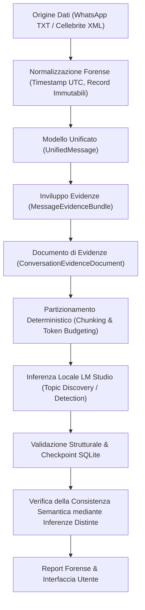
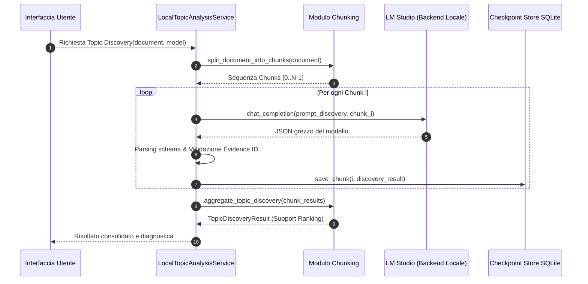
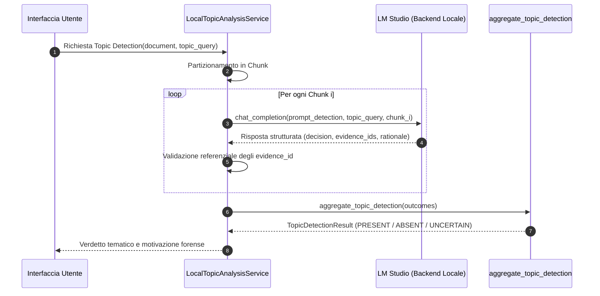
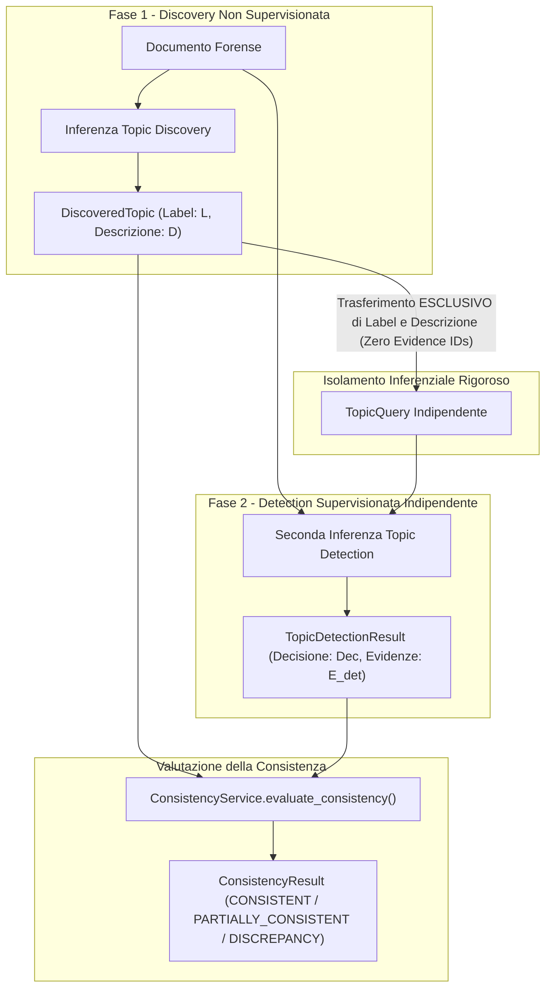
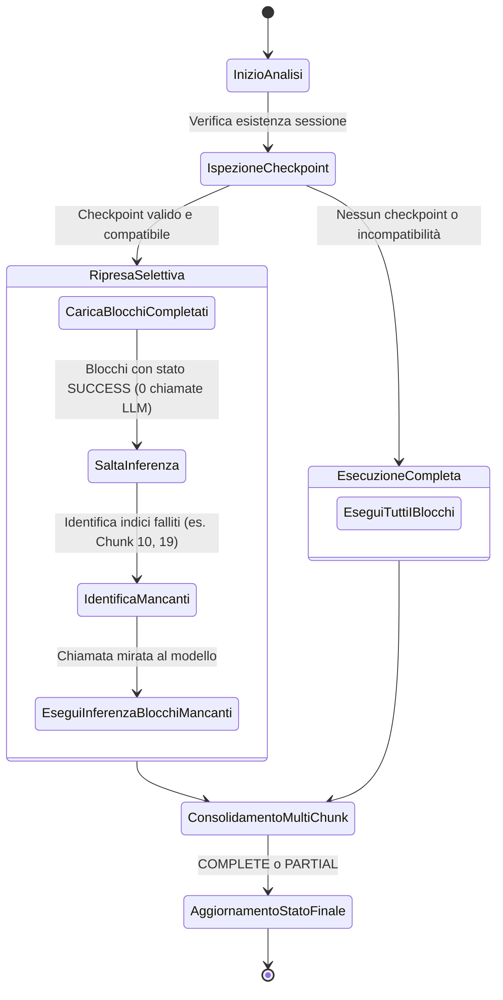

# STRUTTURA DEL MANOSCRITTO PER IL CAPITOLO 3 DELLA TESI

**Capitolo 3:** *Analisi tematica e verifica della consistenza semantica*  
**Autore:** Luca Sorbi  
**Corso di Laurea:** Informatica — Tesi Triennale  
**Finalità:** Guida scientifica, redazionale e concettuale per la stesura definitiva del manoscritto accademico  

---

## 1. LINEE GUIDA REDAZIONALI E REGISTRO LINGUISTICO

La stesura del Capitolo 3 deve conformarsi ai canoni della letteratura scientifica informatica e forense:
- **Linguaggio e stile**: Italiano accademico formale, impersonale, rigoroso ma scorrevole.
- **Divieti stilistici**:
  - Nessuna sequenza di elenchi puntati privi di motivazione o discussione critica.
  - Nessuna trattazione promozionale o elogiativa dell'applicazione o dei framework usati.
  - Nessuna reiterazione della rassegna bibliografica già svolta nel Capitolo 1 e 2.
  - Nessuna anticipazione di risultati sperimentali (che saranno oggetto del Capitolo 4).
  - Nessuna sintesi ridondante a fine capitolo: terminare con una concisa frase di raccordo verso il capitolo successivo.
- **Figure e diagrammi**: Utilizzare esclusivamente diagrammi architetturali e tabelle comparative che chiariscano la dinamica del sistema e la natura delle strutture dati.

---

## 2. DIAGRAMMI ARCHITETTURALI MERMAID

I seguenti diagrammi rappresentano le dinamiche del sistema implementato e devono essere inseriti e commentati organicamente nel testo.

### 2.1 Pipeline complessiva di ChatAnalysis

### 2.2 Flusso Operativo di Topic Discovery

### 2.3 Flusso Operativo di Topic Detection

### 2.4 Verifica della Consistenza Semantica mediante Inferenze Distinte

### 2.5 Gestione di Checkpoint e Ripresa Selettiva

---

## 3. PIANO DETTAGLIATO DELLE SEZIONI

### Sezione 3.1 — Obiettivi e principi dell'analisi tematica

- **Contenuti tecnici da trattare**:
  - Definizione dell'analisi tematica nel contesto della digital forensics e delle investigazioni su chat.
  - La dicotomia tra estrazione aperta (Topic Discovery) e ricerca confermativa (Topic Detection).
  - I vincoli di conformità scientifica: immutabilità probatoria, determinismo, tracciabilità del dato, protezione della riservatezza (rimozione delle risposte grezze su dati non sintetici).
  - L'approccio locale (*on-premises*) mediante Large Language Models a pesi aperti per garantire la non divulgazione del materiale giudiziario verso cloud commerciali.
- **Riferimenti al codice**:
  - `analysis/service.py`: `LocalTopicAnalysisService`.
  - `ai/backend.py`: protocolli di interfacciamento con il backend inferenziale.
- **Tabelle e Figure**:
  - *Figura 3.1*: Pipeline architetturale complessiva di ChatAnalysis.
  - *Tabella 3.1*: Confronto metodologico tra Topic Discovery e Topic Detection (obiettivi, prompt, schemi di output, granularità).

---

### Sezione 3.2 — Preparazione del documento e gestione dei blocchi

- **Contenuti tecnici da trattare**:
  - Trasformazione gerarchica da record estratti a `ConversationEvidenceDocument`.
  - Architettura del partizionamento in chunk deterministici per superare la limitata finestra di contesto del modello linguistico.
  - Algoritmo di *Dynamic Output Budgeting*: calcolo dinamico dei token massimi di completamento per prevenire risposte troncate e preservare la sintassi JSON.
  - Assegnazione di identificatori probatori unici e stabili alle sezioni (`evidence_id`).
- **Riferimenti al codice**:
  - `ai/chunking.py`: `split_document_into_chunks()`, `compute_chunk_partition_fingerprint()`.
  - `ai/token_budget.py`: `calculate_dynamic_output_budget()`, `DEFAULT_SAFETY_MARGIN_TOKENS`.
  - `ai/models.py`: `MessageEvidenceBundle`, `ConversationEvidenceDocument`.
- **Tabelle e Figure**:
  - *Tabella 3.2*: Parametri di budgeting e vincoli operativi (context length 8192, input tokens stimati, safety margin 256).

---

### Sezione 3.3 — Processo di Topic Discovery

- **Contenuti tecnici da trattare**:
  - Formulazione del prompt di Discovery operativo (`topic_discovery_operational_v1`) per l'individuazione di macro-argomenti.
  - La guida sintattica mediante JSON Schema formale (`TOPIC_DISCOVERY_SCHEMA`) applicato a livello di decodifica o tramite grammatiche di campionamento.
  - Gestione del fallimento a livello di singolo blocco (*fault tolerance*): isolamento degli errori di rete o parsing senza interruzione dell'intera pipeline.
  - Tracciamento della diagnostica per chunk (`ChunkDiagnosticRecord`, tentativi, latenza, categoria di errore).
- **Riferimenti al codice**:
  - `analysis/service.py`: `run_topic_discovery()`.
  - `ai/topics.py`: `TopicDiscoveryAnalyzer`.
  - `ai/structured.py`: `TOPIC_DISCOVERY_SCHEMA`.
- **Tabelle e Figure**:
  - *Figura 3.2*: Diagramma di sequenza della Topic Discovery multi-chunk.

---

### Sezione 3.4 — Processo di Topic Detection

- **Contenuti tecnici da trattare**:
  - Formulazione della query tematica (`TopicQuery`) e modalità di interrogazione: solo etichetta (`LABEL_ONLY`) o etichetta con descrizione esplicativa (`LABEL_AND_DESCRIPTION`).
  - La semantica delle decisioni tematiche: `PRESENT`, `ABSENT` e `UNCERTAIN`.
  - Regole assiomatiche di aggregazione: impossibilità di dichiarare `ABSENT` se vi sono blocchi mancanti o falliti (fail-closed scientifico).
- **Riferimenti al codice**:
  - `analysis/service.py`: `run_topic_detection()`.
  - `ai/topics.py`: `TopicDetectionAnalyzer`.
  - `ai/chunking.py`: `aggregate_topic_detection()`.
- **Tabelle e Figure**:
  - *Figura 3.3*: Diagramma di sequenza della Topic Detection.
  - *Tabella 3.3*: Tabella di verità per l'aggregazione delle decisioni multi-chunk in Topic Detection.

---

### Sezione 3.5 — Validazione e aggregazione delle evidenze

- **Contenuti tecnici da trattare**:
  - Normalizzazione e canonizzazione morfologica delle etichette (`canonicalize_topic_label`): fusione di varianti di genere, numero, punteggiatura e stemming radicale.
  - L'algoritmo *Deterministic Support Ranking*: ordinamento dei temi per supporto di chunk indipendenti, ampiezza delle evidenze, posizione temporale e tie-breaker lessicale.
  - Validazione referenziale rigorosa contro le allucinazioni: verifica che ogni `evidence_id` citato esista nel testo del chunk.
- **Riferimenti al codice**:
  - `ai/chunking.py`: `aggregate_topic_discovery()`, `canonicalize_topic_label()`.
  - `analysis/service.py`: validazione referenziale evidence ID.
- **Tabelle e Figure**:
  - *Tabella 3.4*: Esempio applicativo di fusione morfologica e calcolo del punteggio di ranking deterministico.

---

### Sezione 3.6 — Gestione delle analisi parziali e dei checkpoint

- **Contenuti tecnici da trattare**:
  - Il modello di persistenza transazionale su SQLite per il salvataggio incrementale di ogni blocco elaborato.
  - Tracciamento della provenienza: binding tra `document_fingerprint`, `config_fingerprint` e identità del modello (`model_id`).
  - Gestione rigorosa delle sessioni parziali (es. caso empirico 25/26 su Ubuntu): distinzione tra `COMPLETE` e `PARTIAL` senza indebite promozioni di stato.
  - Meccanismo di ripresa selettiva (*selective resume*): identificazione dei soli blocchi mancanti con saltamento garantito a zero chiamate dei blocchi già validati.
  - Protocollo di snapshot isolato e mitigazione TOCTOU F1 mediante tracking del ciclo di vita delle risorse temporanee.
- **Riferimenti al codice**:
  - `analysis/checkpoint.py`: `AnalysisCheckpointStore`, `save_chunk()`, `load_checkpoint()`.
  - `scripts/preflight_checkpoint_resume.py`: `_SnapshotOwnershipTracker`, `create_consistent_readonly_snapshot()`, `_perform_atomic_safe_unlink()`.
- **Tabelle e Figure**:
  - *Figura 3.5*: State diagram del ciclo di vita dei checkpoint e della ripresa selettiva.
  - *Tabella 3.5*: Schema relazionale SQLite (`checkpoints`, `checkpoint_chunks`, `checkpoint_chunk_diagnostics`).

---

### Sezione 3.7 — Verifica della consistenza semantica mediante inferenze distinte

- **Contenuti tecnici da trattare**:
  - Definizione del protocollo formale: una prima inferenza di Topic Discovery seguita da una seconda inferenza di Topic Detection completamente indipendente.
  - Principio dell'isolamento inferenziale: divieto assoluto di passare gli `evidence_id` scoperti alla seconda fase.
  - Autenticazione delle run recuperate da database: ricostruzione deterministica dell'aggregato multi-chunk per evitare falsi fallimenti di provenance (Risoluzione Criticità A3).
  - Analisi delle discrepanze: gestione dei casi `PARTIALLY_CONSISTENT`, `DISCREPANCY_ABSENT` e `DISCREPANCY_UNCERTAIN`.
- **Riferimenti al codice**:
  - `analysis/service.py`: `verify_discovered_topic()`, `_authenticate_recovered_discovery_run_for_verification()`.
  - `analysis/consistency.py`: `ConsistencyService.evaluate_consistency()`.
  - `tests/unit/test_priority1_recovered_discovery_prova_del_nove.py`.
- **Tabelle e Figure**:
  - *Figura 3.4*: Diagramma a blocchi dell'isolamento inferenziale e della valutazione di consistenza.
  - *Tabella 3.6*: Matrice decisionale del `ConsistencyService`.

---

### Sezione 3.8 — Tracciabilità, riproducibilità e limiti metodologici

- **Contenuti tecnici da trattare**:
  - La catena di custodia digitale: dai log forensi all'hash SHA-256 dei documenti e delle configurazioni operative.
  - Condizioni di riproducibilità sperimentale: congelamento dei parametri di campionamento (temperatura $0$, seed deterministico fisso $42$).
  - I limiti metodologici dell'architettura:
    - Differenza epistemologica tra consistenza del modello e correttezza fattuale nel mondo reale.
    - Limiti intrinseci dei filesystem non atomici (impossibilità di garantire unlink condizionale su inode senza controllo esclusivo della cartella).
    - Sensibilità al rumore conversazionale (messaggi vocali privi di trascrizione, gergo non standard, messaggi troncati).
- **Riferimenti al codice**:
  - `analysis/models.py`: `TopicAnalysisRunMetadata`, `AttestationLevel`.
  - `ai/token_budget.py`, `ai/experiment.py`, `ai/benchmark.py`.
- **Frase di raccordo finale**:
  - *Esempio*: "La definizione formale dei processi di discovery, detection e verifica semantica qui delineata costituisce il presupposto metodologico per la campagna sperimentale e l'audit prestazionale che verranno presentati nel Capitolo 4."
