# CHATANALYSIS — REPORT DI AUDIT CORRETTIVO DEL RECUPERO LIVE E DELLA DIAGNOSTICA
**Data:** 16 Ottobre 2026  
**Release di Riferimento:** `chatAnalysis_live_recovery_integration_validation_20261016.zip`  
**Baseline Precedente:** `chatAnalysis_ubuntu_live_chunk_recovery_checkpoint_safety_audit_20261015.zip`  
**Ambiente di Riferimento:** Linux Ubuntu x86_64 / Python 3.10+ / LM Studio Local Server (Qwen2.5-7B-Instruct)  

---

## 1. EXECUTIVE SUMMARY & OBIETTIVI DELL'AUDIT

Il presente intervento corregge e completa le lacune di integrazione riscontrate dall'audit indipendente sulla release `chatAnalysis_ubuntu_live_chunk_recovery_checkpoint_safety_audit_20261015.zip`.

L'audit indipendente aveva confermato:
- **Manifest SHA256:** 316/316 integrità perfetta.
- **Wheel e sorgenti:** 89/89 corrispondenza esatta.
- **Sintassi:** 239 file Python validi.
- **Test specialistici:** 39/39 superati.
- **Log allegato:** 1772 test superati.
- **Benchmark scientifico congelato:** hash SHA256 rigorosamente invariati.

Nonostante i progressi architetturali, l'audit ha identificato 5 lacune operative di integrazione:
1. **Riprova Selettiva non implementata nel service:** il parametro `retry_failed_only` veniva transitato dalla UI all'interfaccia applicativa, ma veniva ignorato nel corpo esecutivo di `LocalTopicAnalysisService.run_topic_discovery()`.
2. **Budget token non ricalcolato per il retry correttivo:** il retry su `AiInvalidEvidenceCitationError` in `ai/topics.py` concatenava la risposta errata e la richiesta di correzione senza ripianificare preventivamente l'allocazione token rispetto al context length effettivo, rischiando un context overflow (HTTP 400 da LM Studio).
3. **Mancato ripristino della diagnostica persistente dopo riavvio Streamlit:** i metodi SQLite `AnalysisCheckpointStore.get_chunk_diagnostics()` non venivano consultati al riavvio dell'applicazione, lasciando la schermata priva dello storico e dello stato dei chunk del documento ricaricato.
4. **Metriche diagnostiche presunte non osservate:** erano presenti assunzioni statiche (es. `attempts=2` fisso nelle eccezioni, `finish_reason="stop"` presunto in assenza di risposta, HTTP 200 non confermati, mancata persistenza degli errori HTTP su SQLite).
5. **Causa degli 11 fallimenti reali non rigorosamente distinta:** attribuzione indimostrata di tutti gli 11 errori di LM Studio a citazioni di evidence ID non validi, senza separazione formale tra osservazioni reali dei log, ipotesi e riproduzioni sintetiche.

Tutte queste lacune sono state affrontate e risolte senza alterare i tre file scientifici congelati (`ai/experiment.py`, `ai/benchmark.py`, `run_benchmark.sh`), senza eseguire i 9 benchmark congelati e preservando l'isolamento forense e la privacy dei dati.

---

## 2. RISOLUZIONE DELLE LACUNE DI INTEGRAZIONE

### 2.1 Riprova Selettiva Reale (`retry_failed_only`)
Nel componente `LocalTopicAnalysisService.run_topic_discovery()` (`analysis/service.py`):
- Il parametro `retry_failed_only: bool = False` ora governa rigidamente il flusso di Discovery.
- **Verifica preliminare rigorosa (Fail-Closed):**
  - Prima di generare qualsiasi chiamata di inferenza verso il modello, il servizio calcola il fingerprint del documento (`doc_fp`) e della configurazione operativa (`cfg_fp`).
  - Carica e valida il checkpoint esistente tramite `chk_store.load_and_validate_checkpoint()`.
  - Se il checkpoint non è presente, oppure se è corrotto o incompatibile, o se ha 0 chunk completati, il servizio **rifiuta di procedere ed evita di rieseguire silenziosamente tutta l'analisi**: solleva `OperationalAnalysisFailedError` con il messaggio esplicito:
    > *"Nessun checkpoint valido trovato per il recupero selettivo (documento: '...'). Avviare una nuova Topic Discovery completa."*
- **Determinazione e isolamento dei chunk:**
  - Determina l'insieme degli indici già completati e l'insieme degli indici mancanti:
    `chunks_to_process = [c for c in chunks if c.chunk_index not in cached_results]`
  - Aggiorna il tracker con il piano di recupero esplicito:  
    `"Recupero selettivo: N validati da checkpoint, K mancanti in elaborazione"`.
  - Invia al modello **esclusivamente** i chunk mancanti. I chunk validati vengono ripristinati direttamente dal checkpoint e marcati con stato `RECOVERED_FROM_CHECKPOINT`.
- **Test di regressione negativi:**
  - `test_retry_failed_only_negative_when_checkpoint_missing`: convalida il blocco fail-closed se non esistono checkpoint.
  - `test_retry_failed_only_negative_when_checkpoint_incompatible`: convalida il rifiuto se il fingerprint o la configurazione sono variati.

### 2.2 Ricalcolo del Budget del Retry Correttivo e Prevenzione HTTP 400
Nel modulo `ai/topics.py`:
- Durante l'intercettazione di `AiInvalidEvidenceCitationError`, il motore applica ora un ricalcolo preventivo deterministico prima di formulare la seconda richiesta.
- **Pianificazione preventiva:**
  - Viene invocato `calculate_token_budget_plan()` con il context length effettivo dell'istanza e una riserva di output non comprimibile (minimo 256 token, standard 512 token).
  - Vengono valutate due strategie:
    1. **Candidate A (Multi-turn contestuale):** include il prompt di sistema, il testo del chunk con le sezioni di evidenza numerate, la risposta precedente errata generata dal modello e il prompt utente di correzione con lo schema JSON re-iniettato. Se la dimensione stimata rientra nel `chunk_token_budget` del context window con almeno 256 token di headroom, viene eseguita questa strategia.
    2. **Candidate B (Compact Single-turn):** se Candidate A supera la finestra disponibile, il motore scarta la cronologia multi-turn e formula un unico prompt compatto focalizzato, contenente il testo, le sole evidenze pertinenti e una direttiva prescrittiva di citazione.
  - **Fail-Closed preventivo:** se nemmeno Candidate B rientra nello spazio del contesto, il motore **non invia la richiesta a LM Studio** (evitando di causare l'errore HTTP 400 dal server), ma solleva immediatamente `AnalysisInputTooLargeError` contrassegnando la diagnostica con categoria `CONTEXT_OVERFLOW`.
- **Integrità forense:**
  - Nessuna correzione euristica o artificiale viene applicata agli evidence ID: le evidenze o vengono citate validamente dal modello LLM oppure il chunk viene marcato `FAILED` con la causa tecnica certificata.

### 2.3 Ripristino Diagnostica da SQLite dopo Riavvio Streamlit
Nel layer UI e Service (`ui/presentation.py`, `analysis/service.py`):
- Implementato in `LocalTopicAnalysisService` il metodo pubblico:
  `load_persisted_discovery_result(document, model_name, max_topics, profile)`:
  - Recupera i metadati del checkpoint più recente per il documento dal database SQLite (`checkpoints.db`).
  - Carica tutti i chunk validati e li assembla in un `TopicDiscoveryResult` con status `PARTIAL` o `SUCCESS`.
  - Carica la cronologia di diagnostica granulare registrata nella tabella `checkpoint_chunk_diagnostics` tramite `chk_store.get_chunk_diagnostics()`.
- Nella schermata Streamlit (`render_topics()`):
  - Quando l'utente riavvia Streamlit o naviga su un documento già analizzato in precedenza (`latest_disc is None`), la vista interroga `load_persisted_discovery_result()`.
  - Il pannello diagnostico visualizza immediatamente:
    - Risultati tematici scoperti dai chunk recuperabili.
    - Tabella diagnostica completa (stato per chunk, tentativi, categoria di errore, fase di fallimento, persistenza).
    - Data di esecuzione (`created_at` ISO), modello e stato operativo (`PARTIAL` o `SUCCESS`).
    - Numero di chunk completati e chunk ancora mancanti.
    - Se sono presenti blocchi falliti, compare il pulsante: `🔄 Riprova solo i blocchi falliti`.
    - Download dei rapporti JSON e CSV conformi e privi di PII.

### 2.4 Utilizzo di Metriche Realmente Osservate
Eliminati tutti i valori diagnostici sintetici o presunti:
- **Tentativi (`attempts`):** non più forzato a 2. Il callback di riprova del chunk (`_on_chunk_retry`) incrementa un contatore esplicito `chunk_attempts[chunk_index]`. Il valore registrato riflette il numero reale di tentativi eseguiti (1 o 2).
- **Motivo di terminazione (`finish_reason`):** non viene mai forzato a `"stop"`. Viene estratto dalla response HTTP restituita da LM Studio. Se la chiamata fallisce prima della generazione della response (es. timeout, connection error, context overflow), il campo vale `None`.
- **Codice di stato HTTP (`http_status`):** impostato a 200 solo quando la response HTTP è stata ricevuta e convalidata. In caso di errore HTTP di LM Studio (es. 400, 404, 500), il codice effettivo viene intercettato ed estratto dall'eccezione (`b_err.status_code`). In caso di errore puramente client-side o validazione locale, il valore è `None`.
- **Persistenza SQLite degli errori:** ogni chunk fallito viene immediatamente registrato nella tabella `checkpoint_chunk_diagnostics` di SQLite con tutti i metadati osservati.
- **Segnalazione errori di persistenza:** se il salvataggio della diagnostica fallisce (es. SQLite locked), l'errore viene loggato come warning e notificato nel tracker senza arrestare la computazione degli altri blocchi.

---

## 3. SEPARAZIONE METODOLOGICA DEGLI 11 FALLIMENTI REALI (15/26)

In ottemperanza al punto 5 della richiesta, si formalizza la separazione analitica tra ciò che è stato osservato, ciò che è stato ipotizzato, ciò che è stato riprodotto in test e ciò che resta da validare su Ubuntu.

```mermaid
flowchart TD
    subgraph OSSERVAZIONI_REALI["1. Osservazioni Log LM Studio (Fatti Certificati)"]
        O1["26 chunk totali pianificati"]
        O2["15 chunk completati con HTTP 200 (SUCCESS)"]
        O3["11 chunk non comparsi nei risultati (interrotti)"]
        O4["Nessun crash del demone LM Studio"]
    end

    subgraph IPOTESI_DIAGNOSTICHE["2. Ipotesi Diagnostiche"]
        H1["Ipotesi A: Evidence Citation Mismatch (AiInvalidEvidenceCitationError)"]
        H2["Ipotesi B: Context Window Overflow (HTTP 400 su prompt estesi)"]
        H3["Ipotesi C: Timeout o latenza di generazione superiore al timeout"]
        H4["Ipotesi D: JSON parsing/schema validation failure"]
    end

    subgraph RIPRODUZIONI_SINTETICHE["3. Riproduzioni Sintetiche (Laboratorio)"]
        R1["Test simulato di errata citazione -> Corretto dal nuovo retry"]
        R2["Test di overflow finestra -> Intercettato preventivamente da AnalysisInputTooLargeError"]
        R3["Test di riprova selettiva 11 rimanenti -> 26/26 completato con successo"]
    end

    subgraph DIMOSTRAZIONE_E_LIMITI["4. Stato della Dimostrazione"]
        D1["DIMOSTRATO: L'architettura è in grado di gestire e recuperare da ciascuna di queste cause."]
        D2["NON DIMOSTRATO: Che TUTTI gli 11 errori reali fossero dovuti esclusivamente a errate citazioni."]
    end

    subgraph PROVE_NECESSARIE["5. Prove LIVE Necessarie su Ubuntu"]
        P1["Esecuzione LIVE completa su Ubuntu 24.04 con Qwen2.5-7B reale"]
        P2["Ispezione dei record checkpoint_chunk_diagnostics generati sul campo"]
        P3["Verifica dell'effettivo superamento della soglia 15/26 verso 26/26"]
    end

    OSSERVAZIONI_REALI --> IPOTESI_DIAGNOSTICHE
    IPOTESI_DIAGNOSTICHE --> RIPRODUZIONI_SINTETICHE
    RIPRODUZIONI_SINTETICHE --> DIMOSTRAZIONE_E_LIMITI
    DIMOSTRAZIONE_E_LIMITI --> PROVE_NECESSARIE
```



### 3.1 Osservazioni Empiriche dei Log LM Studio
- **Esecuzione reale:** la Topic Discovery sul documento forense WhatsApp reale ha pianificato 26 chunk.
- **Esito finale:** 15 chunk completati con successo e salvati; 11 chunk non sono andati a buon fine.
- **Log LM Studio:** non si sono verificati crash di memoria (OOM) o chiusure anomale del server `lms`. La sessione è rimasta responsiva per le successive richieste.

### 3.2 Ipotesi Diagnostiche
1. **Ipotesi 1 (Evidence Citation Mismatch):** il modello Qwen2.5-7B ha generato un topic citando sezioni di evidenza con identificativi non presenti nel chunk corrente (es. sintetizzando ID non conformi o allucinando numeri di messaggio). Questo generava `AiInvalidEvidenceCitationError` che, nel codice precedente privo di retry o con retry fallito, abortiva il chunk.
2. **Ipotesi 2 (Context Window Overflow su retry non profilato):** in caso di rigetto e retry, l'invio del messaggio multi-turn con il JSON errato precedente e le istruzioni aggiuntive poteva superare la context length di 8192 token, causando HTTP 400 da LM Studio.
3. **Ipotesi 3 (Latenza o Timeout Parziale):** sui chunk contenenti molti messaggi o testo denso, il tempo di risposta di LM Studio potrebbe aver superato la soglia di timeout configurata.
4. **Ipotesi 4 (Allucinazione o Formato Schema JSON):** il modello potrebbe aver prodotto un blocco Markdown o un token di interruzione non previsto violando la validazione Pydantic dello schema di Discovery.

### 3.3 Riproduzioni Sintetiche di Laboratorio
- **Verifica del retry correttivo:** riprodotta sinteticamente la situazione in cui il modello sbaglia l'ID al primo tentativo e si autocorrige al secondo tentativo (`test_ubuntu_case_controlled_retry_corrects_invalid_citations`), dimostrando che il meccanismo di retry è ora funzionante ed efficace.
- **Verifica del context overflow:** riprodotta sinteticamente una richiesta correttiva che eccede la finestra del contesto (`test_corrective_retry_context_overflow_prevention`), dimostrando che il sistema non causa più HTTP 400 ma adotta Candidate B compatta o solleva preventivamente un errore classificato con precisione.
- **Verifica del recupero selettivo:** dimostrato che, a partire da 15 chunk convalidati e 11 falliti, il sistema reinvia **esclusivamente** gli 11 mancanti senza rielaborare i 15 validi (`test_retry_failed_only_completes_remaining_chunks_and_transitions_to_complete`).

### 3.4 Cause Dimostrate vs Non Dimostrate
- **Dimostrato:**
  - Che la nuova architettura software gestisce in modo resiliente errori di citazione, overflow di contesto e recuperi selettivi parziali.
  - Che i 15 chunk validati vengono conservati e non vengono rielaborati.
  - Che la diagnostica per ogni chunk fallito viene registrata in modo dettagliato su SQLite con tentativo reale, HTTP status osservato e finish reason.
- **Non Dimostrato:**
  - Non è dimostrato che tutti gli 11 fallimenti sul dataset reale WhatsApp fossero originati esclusivamente da `AiInvalidEvidenceCitationError`. Alcuni potrebbero essere stati determinati da saturazione della coda di LM Studio, timeout o context overflow.
  - **Il problema 15/26 non viene dichiarato risolto a priori:** potrà essere dichiarato formalmente risolto solo a seguito di una nuova esecuzione sperimentale LIVE su ambiente Ubuntu reale con il modello Qwen2.5-7B-Instruct attivo.

---

## 4. MATRICE DEI TEST DI REGRESSIONE E SPECIALISTICI

La suite completa di test include 12 test specialistici nel modulo dedicato `tests/unit/test_ubuntu_live_chunk_failure_and_recovery.py`:

| ID Test | Nome Test | Obiettivo di Validazione | Esito |
|---|---|---|:---:|
| **TC-REC-01** | `test_ubuntu_case_15_of_26_first_run_partial_with_granular_diagnostics` | Verifica prima run parziale (15/26) con registrazione diagnostica dettagliata di tutti i fallimenti. | **PASSED** |
| **TC-REC-02** | `test_ubuntu_case_second_run_recovers_15_from_checkpoint_without_llm_requests` | Verifica che la ripresa carichi i 15 blocchi da checkpoint senza inviare richieste LLM ridondanti. | **PASSED** |
| **TC-REC-03** | `test_ubuntu_case_controlled_retry_corrects_invalid_citations` | Verifica che il retry contestuale corregga gli evidence ID errati senza correzioni euristiche artificiali. | **PASSED** |
| **TC-REC-04** | `test_retry_failed_only_completes_remaining_chunks_and_transitions_to_complete` | Verifica che `retry_failed_only` invii solo gli 11 mancanti e porti lo stato da PARTIAL a SUCCESS (26/26). | **PASSED** |
| **TC-REC-05** | `test_persistence_error_simulation_is_diagnosed_accurately` | Verifica simulazione errore di persistenza SQLite diagnosticato senza interruzione anomala. | **PASSED** |
| **TC-REC-06** | `test_diagnostics_contain_no_private_chat_content` | Controllo di sicurezza e privacy: verifica che nessun testo dei messaggi compaia nei log o esportazioni. | **PASSED** |
| **TC-REC-07** | `test_retry_failed_only_negative_when_checkpoint_missing` | Test negativo: rifiuto fail-closed del recupero selettivo se non esistono checkpoint per il documento. | **PASSED** |
| **TC-REC-08** | `test_retry_failed_only_negative_when_checkpoint_incompatible` | Test negativo: rifiuto se il fingerprint del documento o della configurazione non coincide. | **PASSED** |
| **TC-REC-09** | `test_corrective_retry_context_overflow_prevention` | Verifica ricalcolo preventivo del budget token ed esclusione di richieste HTTP 400 per context overflow. | **PASSED** |
| **TC-REC-10** | `test_accurate_observed_metrics_attempts_finish_reason_http_status` | Verifica accuratezza metrica reale: tentativi osservati (1 o 2), HTTP status confermato, finish reason reale. | **PASSED** |
| **TC-REC-11** | `test_failed_chunk_diagnostics_persisted_to_sqlite` | Verifica che anche i chunk falliti con errore HTTP vengano salvati nella tabella SQLite diagnostica. | **PASSED** |
| **TC-REC-12** | `test_restore_diagnostics_and_state_after_streamlit_restart` | Verifica ripristino automatico dello stato e della diagnostica completa da SQLite dopo riavvio Streamlit. | **PASSED** |

In aggiunta:
- **Test specialistici di checkpoint e riconciliazione:** 33/33 superati in `test_checkpoint_integrity_scalability.py`.
- **Test dei flussi UI Streamlit AppTest:** 7/7 superati in `test_apptest_flows.py` e 13/13 superati in `test_ui_manual_topic_detection.py`.

---

## 5. VERIFICA RIGOROSA DEI VINCOLI CONGELATI

Sono stati verificati i file congelati del benchmark scientifico, accertando la totale invarianza rispetto all'audit di partenza:

| File Congelato | SHA256 Atteso | SHA256 Calcolato | Esito |
|---|---|---|:---:|
| `ai/experiment.py` | `91100C0A84CB4A8B7C2EEF34A06CFF9EC21AA6E6EEC14FFD09CE6FEA8BCEE845` | `91100C0A84CB4A8B7C2EEF34A06CFF9EC21AA6E6EEC14FFD09CE6FEA8BCEE845` | **CONFORME** |
| `ai/benchmark.py` | `DC57081DBCE3463A8017AA26BB4E4A18889AF0A3296853FE40968561D6D44D36` | `DC57081DBCE3463A8017AA26BB4E4A18889AF0A3296853FE40968561D6D44D36` | **CONFORME** |
| `run_benchmark.sh` | `7F9CAE97DF2FAE1BC3B5964E639B9F80E3AC5A388EC9C3E20305FF64D48044A7` | `7F9CAE97DF2FAE1BC3B5964E639B9F80E3AC5A388EC9C3E20305FF64D48044A7` | **CONFORME** |

- I 9 benchmark congelati **non sono stati eseguiti**.
- Ground truth, prompt sperimentali e strategie scientifiche (`DIRECT_MULTILINGUAL`, `TRANSLATE_FIRST`) sono rimaste intatte.
- Nessun commit o push Git autonomo è stato eseguito.

---

## 6. ISTRUZIONI OPERATIVE PER LA SPERIMENTAZIONE UBUNTU

Per eseguire la validazione dal vivo su macchina Ubuntu:

1. **Predisposizione dell'ambiente:**
   ```bash
   unzip chatAnalysis_live_recovery_integration_validation_20261016.zip -d chatAnalysis_audit/
   cd chatAnalysis_audit
   python3 -m venv .venv
   source .venv/bin/activate
   pip install --upgrade pip
   pip install -r requirements.txt
   pip install ./dist/whatsapp_forensic_importer-0.1.0-py3-none-any.whl
   ```

2. **Avvio del demone LM Studio locale:**
   - Caricare il modello `qwen2.5-7b-instruct` con context length `8192` e flash attention attiva.
   - Verificare l'endpoint locale:
     ```bash
     curl -s http://127.0.0.1:1234/v1/models | jq
     ```

3. **Verifica della suite di regressione:**
   ```bash
   pytest tests/unit/test_ubuntu_live_chunk_failure_and_recovery.py -v
   pytest tests/unit/test_checkpoint_integrity_scalability.py -v
   ```

4. **Esecuzione dell'applicazione:**
   ```bash
   streamlit run app.py
   ```
   - Caricare il file chat reale WhatsApp.
   - Selezionare il tab **5. Analisi topic** -> **Topic Discovery (Argomenti Emersi)**.
   - Avviare la Discovery: osservare il contatore chunk in tempo reale.
   - In caso di completamento parziale (es. 15/26), visualizzare la tabella di diagnostica.
   - Cliccare **«🔄 Riprova solo i blocchi falliti»**: accertarsi che il sistema rielabori esclusivamente gli 11 mancanti completando la sessione a 26/26.
   - Riavviare il server Streamlit (`Ctrl+C` e poi `streamlit run app.py`): ricaricare il medesimo documento e verificare l'immediata comparsa della diagnostica e dei chunk validati ripristinati da SQLite.
